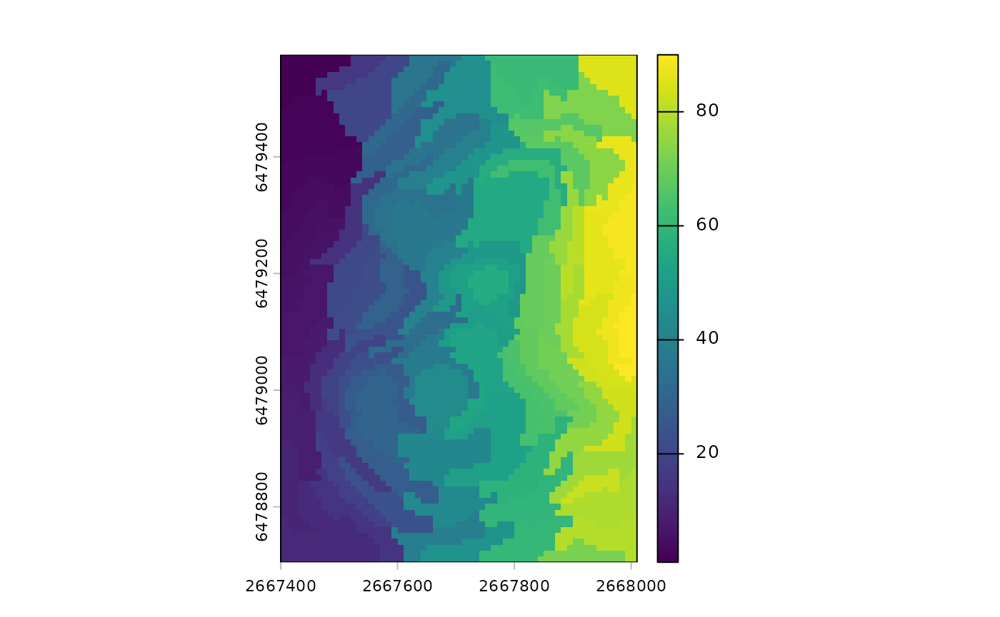
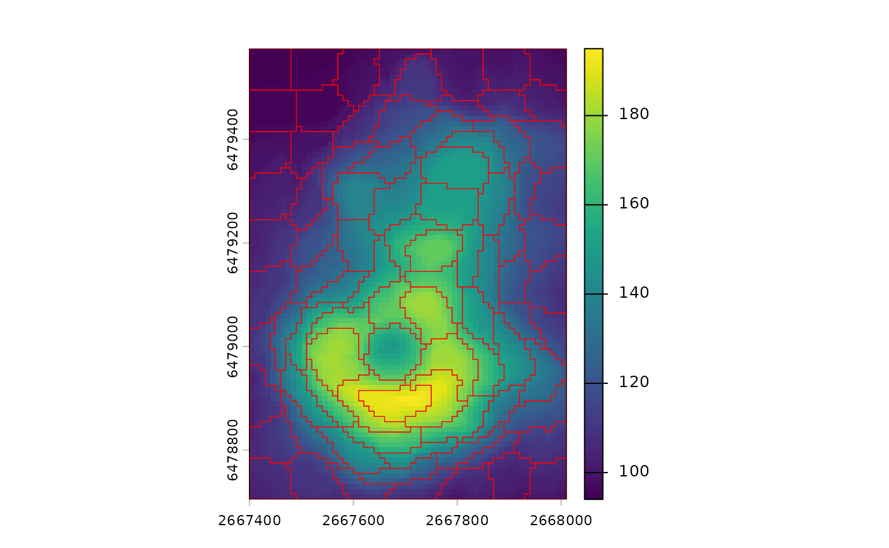
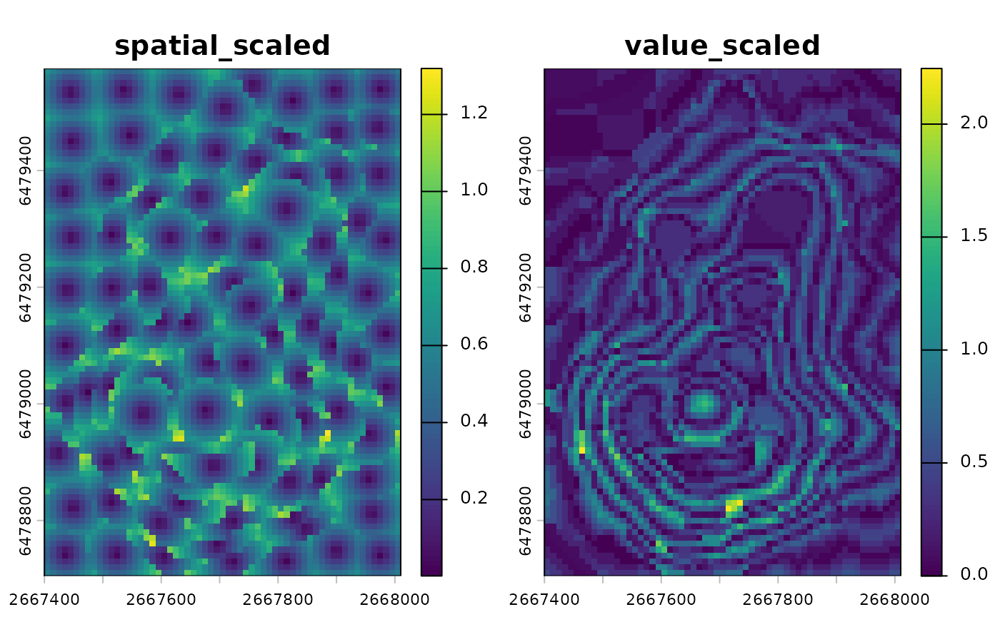
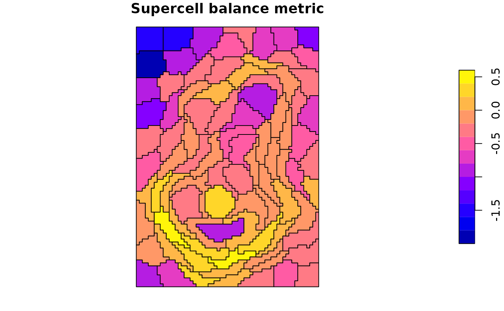
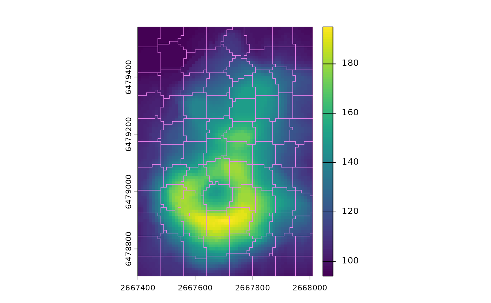

# Main changes since version 1.0.0

This vignette summarizes the main changes in **supercells** since
version 1.0.0. It highlights user-facing updates and points to notable
new functionality.

``` r
library(supercells)
library(terra)
vol <- terra::rast(system.file("raster/volcano.tif", package = "supercells"))
```

## SLIC syntax and outputs

The new version of the **supercells** package introduces a consistent
syntax across functions, with a set of functions with the `sc_` prefix.
The main function in the package is
[`sc_slic()`](https://jakubnowosad.com/supercells/reference/sc_slic.md),
which segments raster data into supercells. It replaces the previous
[`supercells()`](https://jakubnowosad.com/supercells/reference/supercells.md)
function (which is still available for backward compatibility). This
function also has two closely related functions for alternative output
formats:
[`sc_slic_points()`](https://jakubnowosad.com/supercells/reference/sc_slic_points.md)
and
[`sc_slic_raster()`](https://jakubnowosad.com/supercells/reference/sc_slic_raster.md).
[`sc_slic()`](https://jakubnowosad.com/supercells/reference/sc_slic.md)
returns polygon
supercells,[`sc_slic_points()`](https://jakubnowosad.com/supercells/reference/sc_slic_points.md)
returns their centers as points, and
[`sc_slic_raster()`](https://jakubnowosad.com/supercells/reference/sc_slic_raster.md)
returns a raster of supercell IDs.

``` r
# Polygon supercells (sf)
vol_sc <- sc_slic(
  vol,
  step = 8,
  compactness = 1,
  outcomes = c("supercells", "coordinates", "values")
)

# Plot polygons on top of the volcano raster
terra::plot(vol)
plot(sf::st_geometry(vol_sc), add = TRUE, lwd = 0.6, border = "red")
```


``` r
# Supercell centers as points (sf)
vol_pts <- sc_slic_points(
  vol,
  step = 8,
  compactness = 1
)

# Plot points on top of the volcano raster
terra::plot(vol)
plot(sf::st_geometry(vol_pts), add = TRUE, col = "red")
```


``` r
# Supercell IDs as a raster (SpatRaster)
vol_ids <- sc_slic_raster(
  vol,
  step = 8,
  compactness = 1
)

# Plot raster IDs
terra::plot(vol_ids)
```



While,
[`sc_slic()`](https://jakubnowosad.com/supercells/reference/sc_slic.md)
is the main function, the other two functions are useful for specific
tasks. For example,
[`sc_slic_points()`](https://jakubnowosad.com/supercells/reference/sc_slic_points.md)
is helpful for inspecting supercell center locations, while
[`sc_slic_raster()`](https://jakubnowosad.com/supercells/reference/sc_slic_raster.md)
is useful for large datasets where polygon outputs may be too
memory-intensive.

## Compactness tuning and iteration diagnostics

Use
[`sc_tune_compactness()`](https://jakubnowosad.com/supercells/reference/sc_tune_compactness.md)
to estimate a compactness value from local value variability at the
chosen `step`, then run
[`sc_slic()`](https://jakubnowosad.com/supercells/reference/sc_slic.md)
with the tuned value.

``` r
# Estimate compactness from local value variability
comp_tune <- sc_tune_compactness(vol, step = 8)
comp_tune
#>   step            metric  dist_fun compactness
#> 1    8 local_variability euclidean    9.241536

# Use the tuned value and plot results
vol_sc_tuned <- sc_slic(vol, step = 8, compactness = comp_tune$compactness)
terra::plot(vol)
plot(sf::st_geometry(vol_sc_tuned), add = TRUE, lwd = 0.6, border = "red")
```



[`sc_slic_convergence()`](https://jakubnowosad.com/supercells/reference/sc_slic_convergence.md)
provides iteration diagnostics so you can visualize convergence in mean
distance across iterations.

``` r
# Iteration diagnostics plot
vol_conv <- sc_slic_convergence(
  vol,
  step = 8,
  compactness = 1,
  iter = 10
)
plot(vol_conv)
```


## Metrics for evaluating results

Three new functions,
[`sc_metrics_pixels()`](https://jakubnowosad.com/supercells/reference/sc_metrics_pixels.md),
[`sc_metrics_supercells()`](https://jakubnowosad.com/supercells/reference/sc_metrics_supercells.md),
and
[`sc_metrics_global()`](https://jakubnowosad.com/supercells/reference/sc_metrics_global.md),
provide metrics to evaluate supercell segmentation quality at different
levels of detail. Pixel-level metrics show distances from each cell to
its assigned center (lower is more compact/homogeneous). Supercell-level
metrics summarize those distances by supercell, and global metrics
provide a single-row overview for comparisons.

``` r
vol_sc <- sc_slic(
  vol,
  step = 8,
  compactness = 7,
  outcomes = c("supercells", "coordinates", "values")
)

# Per-pixel metrics (SpatRaster)
pixel_metrics <- sc_metrics_pixels(vol, vol_sc, metrics = c("spatial", "value"))

# Plot a pixel-level metric
terra::plot(pixel_metrics)
```



``` r
# Per-supercell metrics (sf)
supercell_metrics <- sc_metrics_supercells(vol, vol_sc)
head(supercell_metrics)
#> Simple feature collection with 6 features and 5 fields
#> Geometry type: POLYGON
#> Dimension:     XY
#> Bounding box:  xmin: 2667400 ymin: 6479025 xmax: 2667500 ymax: 6479575
#> Projected CRS: NZGD49 / New Zealand Map Grid
#>   supercells mean_spatial_dist_scaled mean_value_dist_scaled mean_combined_dist
#> 1          1                0.4095206             0.09007318          0.4222508
#> 2          2                0.4312237             0.06200361          0.4380981
#> 3          3                0.3717557             0.16420635          0.4168714
#> 4          4                0.4261679             0.14332676          0.4633701
#> 5          5                0.4191004             0.30019033          0.5423462
#> 6          6                0.4520404             0.30186667          0.5812408
#>      balance                       geometry
#> 1 -1.5143648 POLYGON ((2667400 6479575, ...
#> 2 -1.9394344 POLYGON ((2667410 6479495, ...
#> 3 -0.8171130 POLYGON ((2667400 6479405, ...
#> 4 -1.0897063 POLYGON ((2667450 6479335, ...
#> 5 -0.3336939 POLYGON ((2667440 6479245, ...
#> 6 -0.4037861 POLYGON ((2667460 6479165, ...
plot(supercell_metrics["balance"], main = "Supercell balance metric")
```



``` r
# Global metrics (single-row summary)
global_metrics <- sc_metrics_global(vol, vol_sc)
global_metrics
#>   step compactness compactness_method n_supercells mean_spatial_dist_scaled
#> 1    8           7           constant           88                0.4466124
#>   mean_value_dist_scaled mean_combined_dist    balance
#> 1              0.3710111          0.6294388 -0.2780825
```

## ASLIC adaptive compactness

`compactness = use_adaptive()` enables adaptive compactness (ASLIC).
This lets the method adjust compactness across supercells rather than
using a single fixed value.

``` r
vol_sc_aslic <- sc_slic(vol, step = 8, compactness = use_adaptive())

# Plot results on top of the volcano raster
terra::plot(vol)
plot(sf::st_geometry(vol_sc_aslic), add = TRUE, lwd = 0.6, border = "violet")
```



## Other changes

- New utilities: Added
  [`use_meters()`](https://jakubnowosad.com/supercells/reference/use_meters.md)
  helper for `step` and
  [`use_adaptive()`](https://jakubnowosad.com/supercells/reference/use_adaptive.md)
  for adaptive compactness in
  [`sc_slic()`](https://jakubnowosad.com/supercells/reference/sc_slic.md)/[`sc_slic_points()`](https://jakubnowosad.com/supercells/reference/sc_slic_points.md)/[`sc_slic_raster()`](https://jakubnowosad.com/supercells/reference/sc_slic_raster.md).
- Behavior: Since version 1.0, the way coordinates are summarized
  internally has changed, and results in versions after 1.0 may differ
  slightly from those prior to 1.0.
- Performance: Improved speed and memory efficiency.
- Chunking and memory: Chunk sizes align to `step`, deterministic ID
  offsets are used for file-backed merges, and
  `options(supercells.chunk_mem_gb)` controls memory.
- Parallelization: Removed **future**-based parallel chunking.
