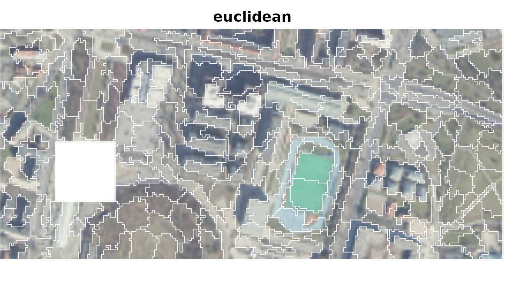
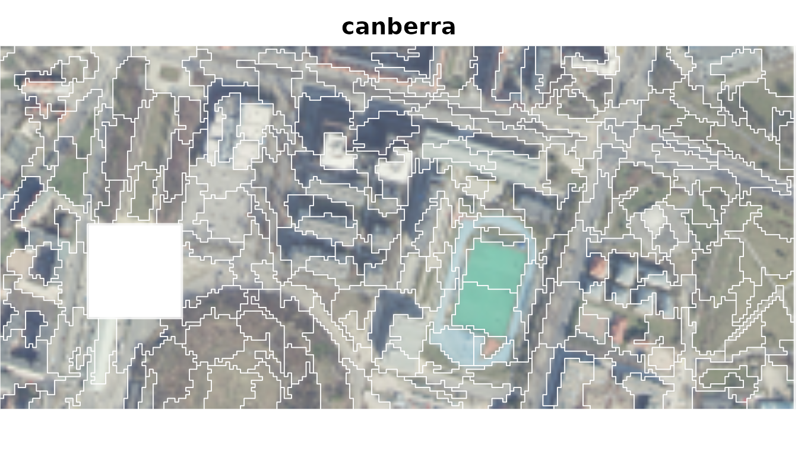
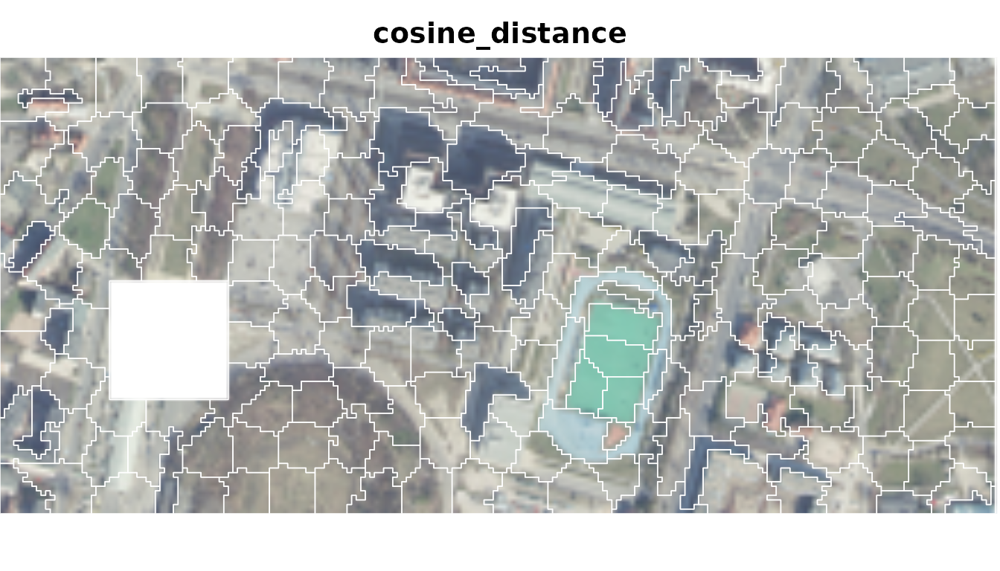
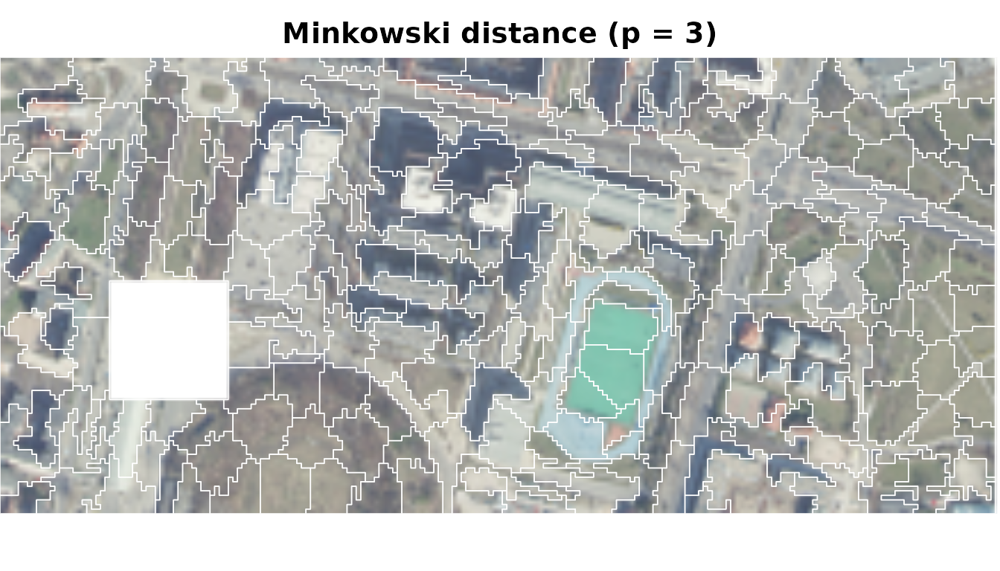

# Choosing a distance measure for supercells

The distance measure defines what it means for the values of two raster
cells to be similar. Therefore, the choice of a distance measure is
crucial for the supercell segmentation results, and the decision of
which measure to use should be based on the characteristics of the input
data and the goals of the analysis. This vignette provides an overview
of the available distance measures, their requirements, and guidance for
selecting an appropriate measure for your analysis. It also includes a
short example comparing three different measures on a sample raster
dataset.

``` r
library(supercells)
library(terra)
```

## Available measures

To check the available distance measures, use the
[`sc_list_distances()`](https://jakubnowosad.com/supercells/reference/sc_list_distances.md)
function. It returns a data frame with information on the measure names,
required input domains, what the measure compares, the effect of layer
rescaling, and guidance for choosing the measure. Below is a summary of
the available measures, grouped by input domain. The “Layer rescaling”
column indicates whether differences in scale among layers affect the
distance.

### Input: Numeric Values

| Name | What it compares | Layer rescaling | Guidance |
|:---|:---|:---|:---|
| euclidean | root-sum-square layer differences | can change distance | Scale layers to comparable units or ranges. |
| squared_euclidean | summed squared layer differences | can change distance | Scale layers to comparable units or ranges. |
| manhattan | summed absolute layer differences | can change distance | Scale layers to comparable units or ranges. |
| chebyshev | largest absolute layer difference | can change distance | Scale layers to comparable units or ranges. |
| canberra | relative layer differences | no effect | Layer scaling has no effect. |
| lorentzian | summed log-scaled layer differences | can change distance | Scale layers to comparable units or ranges. |
| cosine_distance | pattern across layers, ignoring overall scale | can change distance | Scale layers only to change their influence. |

### Input: Nonnegative Values

| Name | What it compares | Layer rescaling | Guidance |
|:---|:---|:---|:---|
| soergel | difference relative to larger values | can change distance | Scale layers to set their influence. |
| wavehedges | summed relative layer differences | no effect | Layer scaling has no effect. |
| czekanowski | difference relative to total magnitude | can change distance | Scale layers to set their influence. |
| squared_chord | differences after square-root transformation | can change distance | Scale layers to set their influence. |
| squared_chi | squared differences relative to combined values | can change distance | Scale layers to set their influence. |
| clark | combined relative layer differences | no effect | Layer scaling has no effect. |

### Input: Probabilities Summing to 1

| Name | What it compares | Layer rescaling | Guidance |
|:---|:---|:---|:---|
| jsd | difference between probability profiles | requires renormalization | Normalize every cell to sum to 1 and use mean centres. |
| non-intersection | probability assigned differently across layers | requires renormalization | Normalize every cell to sum to 1 and use mean centres. |

### Input: Probabilities in Equal-Width Bins Summing to 1

| Name | What it compares | Layer rescaling | Guidance |
|:---|:---|:---|:---|
| wasserstein1 | probability mass shifted across ordered bins | requires renormalization | Normalize every cell to sum to 1, use mean centres, and arrange layers in bin order. |

### Input: Ordered Numeric Sequence

| Name | What it compares | Layer rescaling | Guidance |
|:---|:---|:---|:---|
| dtw | sequence difference after alignment | can change distance | Arrange layers in sequence order. |

### Input: Two Equal-Length Coordinate Sequences

| Name | What it compares | Layer rescaling | Guidance |
|:---|:---|:---|:---|
| dtw2d | 2D trajectory difference after alignment | can change distance | Arrange layers by dimension, with sequence order within each dimension. |

## Comparing three measures

We illustrate segmentations obtained with three distance measures:
`euclidean`, `canberra`, and `cosine_distance`. Each measure is tuned
separately because their distance values have different scales.

``` r
ortho <- rast(system.file("raster/ortho.tif", package = "supercells"))
ortho <- aggregate(ortho, fact = 2)

tune_euclidean <- sc_tune_compactness(ortho, step = 10, dist_fun = "euclidean")
sc_euclidean <- sc_slic(
  ortho,
  step = 10,
  compactness = tune_euclidean$compactness,
  dist_fun = "euclidean"
)

tune_canberra <- sc_tune_compactness(ortho, step = 10, dist_fun = "canberra")
sc_canberra <- sc_slic(
  ortho,
  step = 10,
  compactness = tune_canberra$compactness,
  dist_fun = "canberra"
)

tune_cosine <- sc_tune_compactness(ortho, step = 10, dist_fun = "cosine_distance")
sc_cosine <- sc_slic(
  ortho,
  step = 10,
  compactness = tune_cosine$compactness,
  dist_fun = "cosine_distance"
)
```



Each measure produces a different segmentation of the raster dataset:

- Euclidean distance responds to absolute RGB differences.
- Canberra distance compares channel differences relative to their
  values.
- Cosine distance compares the RGB profile while ignoring its overall
  magnitude.

## Custom measures

Other measures can be supplied as functions. A custom function must take
two numeric vectors and return one finite, nonnegative value, with
smaller values meaning greater similarity.

For example, Minkowski distance with $`p = 3`$ gives large layer
differences more influence than Euclidean distance ($`p = 2`$);
Chebyshev distance is the limiting case as $`p`$ approaches infinity.

``` r
minkowski3 <- function(x, y) {
  sum(abs(x - y)^3)^(1 / 3)
}

tune_minkowski3 <- sc_tune_compactness(
  ortho,
  step = 10,
  dist_fun = minkowski3
)

sc_minkowski3 <- sc_slic(
  ortho,
  step = 10,
  compactness = tune_minkowski3$compactness,
  dist_fun = minkowski3
)
```


